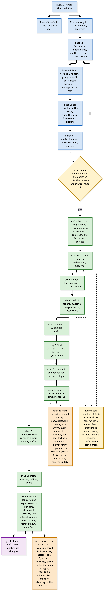

# Appendix: the regolith migration

The architecture in this book arrived on purpose. Before regolith, defradb.rs ran on a
conventional embedded KV layer with the database doing its own coordination: a shared
transaction mutex, per-document write queues, a head cache, an arrival guard, a batch
gate, collection and peer RwLocks, an ACP mutex, eleven retry loops, and tokio
runtimes (four of them) reaching into the data path. The migration plan below is the
recorded route from that architecture to this one; its phases and steps landed on
`main`, each gated by its benchmarks (conflict rate never rises, throughput never
drops, at 1/4/16/64 writers), and the deletion nodes are what was deleted on the way.

## Reading the plan

- **Phases 2-8 (blue)** built regolith itself: the defect fixes every user needs, the
  TLA+ models, the DefraLevel mechanisms (key classes, conflict reasons, regolith
  sync), then WAL/ingest/group commit, per-thread IoQueues, encryption at rest, the
  per-core hot paths and the lock-free commit pipeline, and the verification run that
  gated the release.
- **Steps 0-9 (green)** moved defradb.rs onto it, in order: plain fixes first, then
  the classifier, then every decision inside its transaction, then append/allocate/
  merges/parts and the head-set route, events by commit receipt, then (with the
  data-path traits made synchronous) `transact` and per-reason business logic, then
  lock deletion one at a time, telemetry from engine tickers, proofs updated, and
  finally thread-per-core with document affinity and the single network runtime.
- **The gates (yellow)** ran at every step: the benchmark baseline at 1/4/16/64
  writers, conflict rate and throughput held, integration and counter conformance
  green.
- **The deletions (orange)** are the point: the pool's arrival deleted the SharedTxn
  RwLock, the shared DbTxn mutex, the action lock, cache locks, `block_on` bridges,
  and tokio from the data path; step 6 deleted the head cache, DocWriteQueue,
  batch gate, arrival guard, collection RwLock, per-peer RwLock, the ACP mutex, the
  eleven retry loops, counter finalize, arrival RMW, the forced block read and
  `has_for_update`.

## Where to see it today

Every chapter of this book describes the end state: the [keys](../storage/keys.md)
the classifier assigns, the [merge operator](../storage/merge-operator.md), [commit
receipt ordering](../txn/commit.md), [thread-per-core](../threading/why.md), the [one
network edge](../threading/edge.md), and the repository rules that keep the boundary
from growing back ("defradb.rs carries no transaction mechanics; changes only ever
remove coordination").

> **Why keep the plan in the book.** The deletions are the argument. An architecture
> claim is cheap; a list of locks that no longer exist, each deleted behind a
> benchmark that did not regress, is the evidence. And the plan is the map for the
> next migration of this kind: mechanism first, proofs beside it, then move the
> database one decision at a time, deleting as you go.
